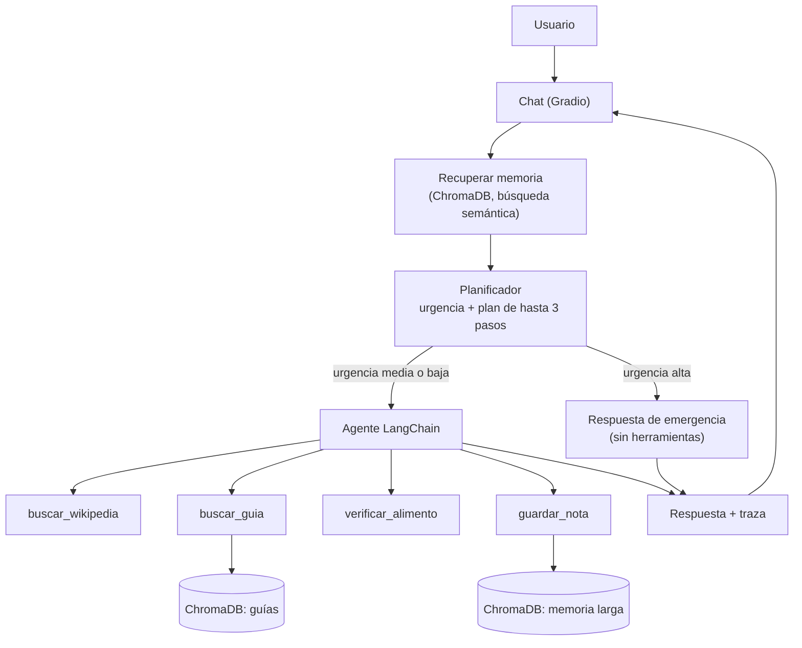

# 🐾 Huellas — Agente de ayuda para dueños de mascotas

Chat con un agente de IA que orienta a personas con perros y gatos: responde dudas de cuidado, revisa la seguridad de alimentos, recuerda datos de cada usuario y detecta urgencias. Proyecto de la asignatura **ISY0101 — Ingeniería de Soluciones con Inteligencia Artificial** (Evaluación Parcial 2).


---

## 1. Caso organizacional

Programa de tenencia responsable (caso simulado) que ofrece un servicio de orientación para cualquier persona con una mascota. El agente ayuda con:

- **Cuidados:** vacunas, desparasitación, alimentación, higiene, ejercicio y adopción responsable.
- **Seguridad:** qué alimentos son tóxicos o peligrosos para perros y gatos.
- **Urgencias:** detecta casos graves y recomienda acudir de inmediato a un veterinario.

## 2. Arquitectura



**Flujo de un mensaje**

1. Gradio recibe el mensaje y el historial de la conversación (memoria de corto plazo).
2. Se recuperan por significado los recuerdos del usuario guardados antes (memoria de largo plazo).
3. El **planificador** clasifica la urgencia (alta, media o baja) y arma un plan breve.
4. Si la urgencia es **alta**, el asistente responde de inmediato y sin herramientas. En los demás casos, el **agente de LangChain** ejecuta el plan usando sus herramientas.
5. La respuesta incluye una línea de traza con la urgencia, el plan y las herramientas usadas.

## 3. Componentes

### Herramientas

| Herramienta | Tipo | Función |
|---|---|---|
| `buscar_wikipedia` | Consulta | Resumen de Wikipedia (en español) sobre razas, especies o conceptos. |
| `buscar_guia` | Consulta | Búsqueda semántica (RAG) en las guías de cuidado de la organización. |
| `verificar_alimento` | Razonamiento | Reglas que indican si un alimento es tóxico, peligroso o requiere precaución. |
| `guardar_nota` | Escritura | Guarda datos duraderos del usuario o su mascota (nombre, edad, alergias, rutina). |

### Memoria

- **Corto plazo:** historial reciente del chat, enviado al agente en cada turno.
- **Largo plazo:** notas almacenadas en ChromaDB con embeddings multilingües (`paraphrase-multilingual-MiniLM-L12-v2`). Se recuperan por similitud de significado, no por palabras exactas.

### Planificación y decisiones adaptativas

Antes de actuar, el planificador decide la **urgencia** y un **plan**. Según la urgencia, el sistema cambia de ruta: respuesta inmediata para emergencias, o agente con herramientas para el resto. El plan y las herramientas utilizadas se muestran bajo cada respuesta.

## 4. Tecnologías

| Componente | Tecnología |
|---|---|
| Framework de agentes | LangChain |
| Modelo de lenguaje | `openai/gpt-oss-120b` en Groq (API compatible con OpenAI) |
| Base vectorial | ChromaDB |
| Embeddings | Sentence Transformers (modelo multilingüe, ejecución local) |
| Interfaz | Gradio |
| Entorno | Google Colab |

## 5. Cómo ejecutarlo

### Requisitos

- Cuenta de Google (para Colab).
- API key de [Groq](https://console.groq.com/).

### Pasos

1. Abre `huellas_chat_gradio.ipynb` en Google Colab (botón **Abrir en Colab** de arriba, o sube el archivo manualmente).
2. En Colab, abre el panel **Secretos** (ícono de llave 🔑) y crea un secreto llamado `GROQ_API_KEY` con tu clave. Activa **Acceso desde el notebook**.
3. Ejecuta las celdas **en orden** (*Entorno de ejecución → Ejecutar todo*). La primera vez, la instalación y la descarga del modelo de embeddings pueden tardar unos minutos.
4. La celda del chat muestra la interfaz dentro del notebook y entrega un **enlace público** (`gradio.live`) para abrirla en otra pestaña o dispositivo. El enlace funciona solo mientras la sesión de Colab siga activa.


### Ejecución local (opcional)

El notebook está pensado para Colab (usa `google.colab.userdata`). Para ejecutarlo localmente, instala las dependencias con `pip install -r requirements.txt`, define la variable de entorno `GROQ_API_KEY` y reemplaza la lectura de secretos de Colab en la celda de configuración del modelo.

## 6. Ejemplos de uso

| Mensaje del usuario | Comportamiento esperado |
|---|---|
| "¿Cuáles son los alimentos tóxicos para mi perro?" | Consulta las guías y verifica alimentos con la herramienta de reglas. |
| "¿A qué edad es recomendable esterilizar a mi mascota?" | Consulta información en guías o Wikipedia. |
| "Mi perra se comió una barra de chocolate" | Detecta **urgencia alta** y responde de inmediato recomendando acudir a un veterinario. |
| "Mi gata Michi es alérgica al pollo" → (más tarde) "¿Qué premio le puedo dar a Michi?" | Guarda la nota y la recupera después desde la memoria de largo plazo. |

## 7. Pruebas

El notebook incluye una celda de pruebas que verifica:

- La herramienta de seguridad alimentaria marca alimentos tóxicos.
- La búsqueda semántica devuelve la guía relevante.
- Una nota guardada se recupera correctamente desde la memoria de largo plazo.
- El planificador clasifica una emergencia como urgencia alta y una consulta general como baja o media.


## 8. Estructura del repositorio

```
.
├── README.md
├── requirements.txt
├── huellas_chat_gradio.ipynb    

```

## 9. Limitaciones y mejoras futuras

- Las reglas de `verificar_alimento` cubren solo una lista acotada de alimentos.
- La memoria de largo plazo se guarda en el disco de Colab y se pierde al reiniciar el entorno.
- La capa gratuita de Groq tiene límites de uso, por lo que muchas consultas seguidas pueden fallar.
- Mejoras posibles: guardar la memoria en Google Drive, ampliar las guías de cuidado y evaluar las respuestas con más casos de prueba.

## 10. Autoría

- **Autor/a:** Bastian Rojas Duarte

